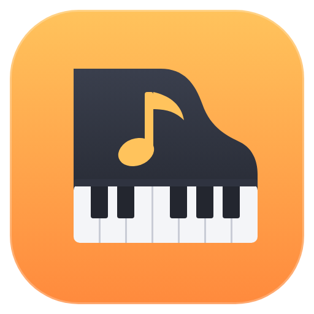
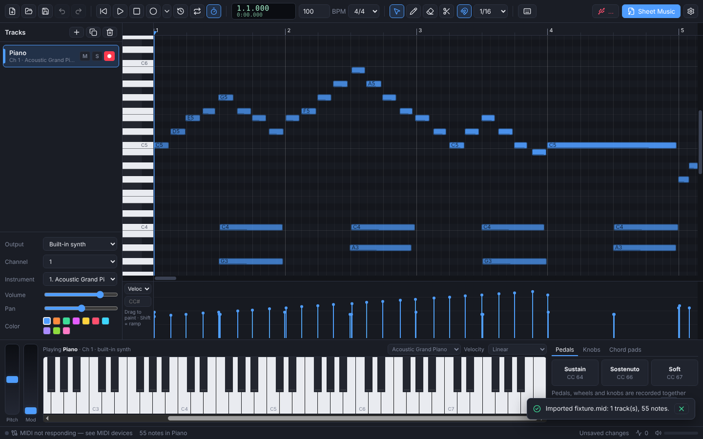
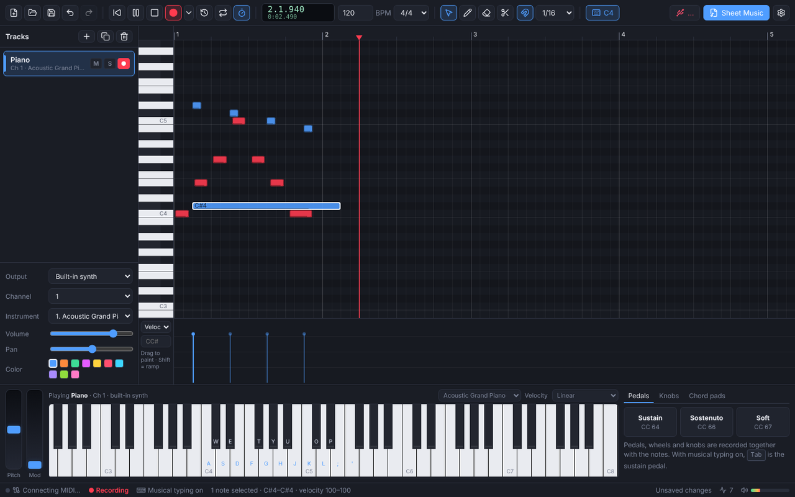
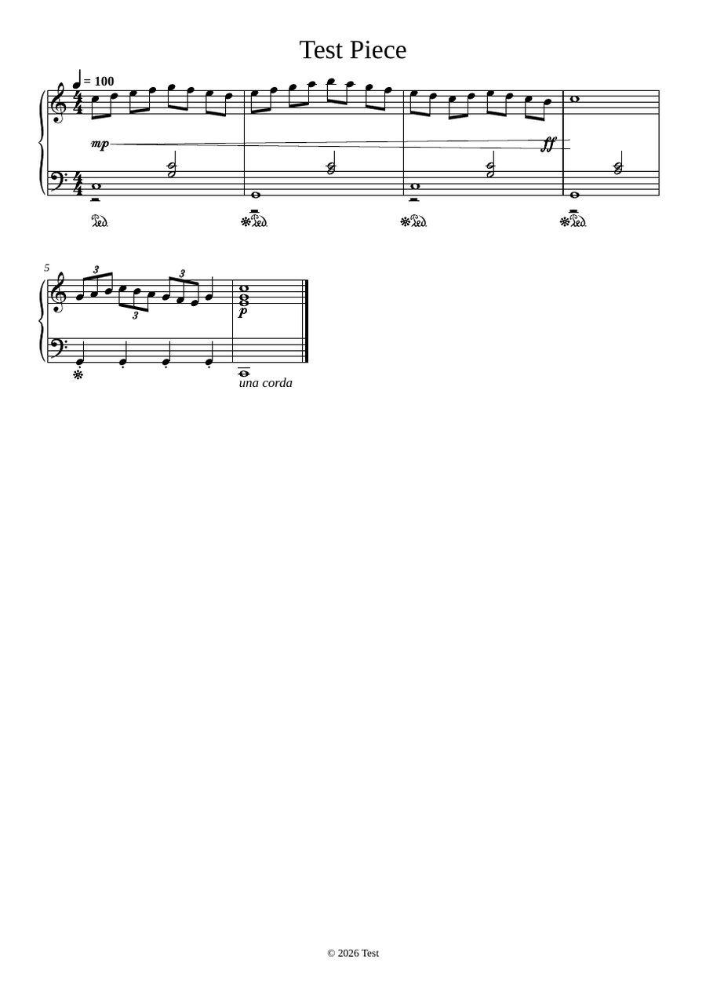

<p align="center">
  
</p>

<h1 align="center">Synth Piano</h1>

<p align="center">
  A Windows MIDI controller, recorder and piano-roll editor that turns what you play into sheet music.
</p>

<p align="center">
  <a href="https://github.com/Ranzlappen/synth-piano/releases/latest"><b>⬇ Download for Windows</b></a> ·
  <a href="docs/SHEET_MUSIC_EXPORT.md">Sheet music export</a> ·
  <a href="docs/MIDI_SETUP.md">MIDI &amp; USB-C setup</a> ·
  <a href="#keyboard-shortcuts">Shortcuts</a>
</p>



## Features

### 🎹 MIDI controller
- Works with **USB / USB-C MIDI keyboards and controllers**: class-compliant devices need no driver and can be plugged in and out while the app runs. Driver-based devices, MIDI interfaces, Bluetooth MIDI and virtual ports (loopMIDI, Windows MIDI Services) work too.
- **On-screen 88-key keyboard**: multi-touch, velocity from where you touch the key.
- **Pitch-bend and mod wheels**, **sustain / sostenuto / soft pedals** (hold or latch), **8 assignable CC knobs** and **8 chord pads**.
- **Musical typing**: play with the computer keyboard (<kbd>Ctrl</kbd>+<kbd>K</kbd>). Keys are mapped by physical position, so QWERTY and German QWERTZ behave the same. <kbd>Tab</kbd> is the sustain pedal, <kbd>1</kbd>–<kbd>8</kbd> are the chord pads.
- Route each track to the **built-in synth** (a General MIDI sound set that responds to velocity, pedals and controllers) or to any **MIDI output**: hardware synths, sound modules, or DAWs through a virtual port. MIDI thru, MIDI clock output and velocity curves are built in.

### ⏺ Comprehensive recording
- Records **everything that carries musical expression**:
  - note-on velocity and release velocity,
  - sustain pedal including **half-pedalling**, sostenuto and soft pedal,
  - expression, modulation and other controllers, knob moves,
  - pitch bend, channel and polyphonic aftertouch, program changes.
- Count-in, metronome, overdub or replace, **loop recording**, latency compensation.
- **Capture** (<kbd>Ctrl</kbd>+<kbd>Shift</kbd>+<kbd>R</kbd>): forgot to press Record? Insert what you just played.
- Notes appear live while you play.



### 🎼 Side-scrolling MIDI editor
- Canvas piano roll that stays fast with large recordings. Zoom with <kbd>Ctrl</kbd>/<kbd>Alt</kbd>+wheel; the view can follow the playhead.
- Tools for **select / draw / erase / split**:
  - move, resize, <kbd>Alt</kbd>-drag duplicate, marquee selection,
  - snapping to straight or triplet grids (<kbd>Shift</kbd> to bypass),
  - audition while editing.
- **Velocity and controller lanes**: paint and ramp velocities; draw or erase sustain, soft pedal, expression, modulation, volume, pan, pitch bend, aftertouch or any CC.
- Quantize (strength and swing), transpose, legato, humanize, cut / copy / paste / duplicate, and **unlimited undo/redo**.
- Multiple tracks with mute, solo, arm, channel, General MIDI instrument, volume, pan and colour, plus ghost notes of the other tracks.
- Tempo and time signature, loop region, metronome, and scale highlighting.

### 📄 Sheet music export (PDF & MusicXML)
- Turns live performances into readable notation, all automatically:
  - quantisation with **triplet detection** and swing straightening,
  - **hand splitting** onto a grand staff and **two voices** per staff,
  - ties, beams, tuplets, pickup bars,
  - key detection and correct spelling.
- Musical expression from your playing: **dynamics** (*pp* … *ff*) and **hairpins** from velocities, **pedal marks** from the sustain pedal, *una corda* from the soft pedal, **staccato** and **accents**, and tempo marks.
- Every parameter is adjustable, including tempo for free-time playing (with **tempo detection**), note-value scale, meter, key, transposition, staves, paper, staff size, margins, bars per line, bar numbers and music font. There's a **live preview** of the exact pages.
- Vector **PDF** with embedded fonts, or **MusicXML** for MuseScore, Dorico, Finale and Sibelius.
- See the full [parameter guide](docs/SHEET_MUSIC_EXPORT.md).

<p align="center"></p>

### 💾 Files
- Projects are saved as `.synthpiano` files (associated with the app by the installer).
- Import and export **Standard MIDI Files** (type 0/1) with all controllers, tempo and meter.
- Recent files, autosave and crash recovery, unsaved-changes protection.
- Automatic **updates** from GitHub Releases (installer version).

## Installation

Download from the [latest release](https://github.com/Ranzlappen/synth-piano/releases/latest):

| File | Use |
| --- | --- |
| `Synth-Piano-Setup-<version>.exe` | Installer. Adds Start menu and desktop shortcuts and the file association, and updates itself. |
| `Synth-Piano-<version>-Portable.exe` | Portable version. No installation and no automatic updates. |

Requires Windows 10 or 11 (64-bit). The builds are not code-signed yet, so Windows
SmartScreen may show *"Windows protected your PC"* on first start. Choose
**More info → Run anyway**.

## Quick start

1. Connect your MIDI keyboard. It appears in the status bar; check **MIDI → MIDI Devices…** if not.
2. Play: you hear the built-in piano. Choose another instrument or a MIDI output in the track inspector.
3. Press <kbd>R</kbd> to record (one bar count-in), and <kbd>Space</kbd> to stop.
4. Edit in the piano roll, adjust velocities and pedalling in the lanes below.
5. Press <kbd>Ctrl</kbd>+<kbd>P</kbd> (**Sheet Music**), check the preview and export a PDF.

## Keyboard shortcuts

| Keys | Action |
| --- | --- |
| <kbd>Space</kbd> / <kbd>Enter</kbd> | Play-pause / stop and return |
| <kbd>R</kbd>, <kbd>Ctrl</kbd>+<kbd>Shift</kbd>+<kbd>R</kbd> | Record / capture the last performance |
| <kbd>L</kbd> / <kbd>M</kbd> / <kbd>F</kbd> | Loop / metronome / follow playhead |
| <kbd>1</kbd>–<kbd>4</kbd> | Select, draw, erase, split tool |
| <kbd>Q</kbd> / <kbd>Shift</kbd>+<kbd>Q</kbd> | Quantize / quantize options |
| <kbd>↑</kbd> <kbd>↓</kbd> (<kbd>Shift</kbd>) | Transpose a semitone (octave) |
| <kbd>Ctrl</kbd>+<kbd>C</kbd>/<kbd>X</kbd>/<kbd>V</kbd>/<kbd>D</kbd> | Copy / cut / paste / duplicate |
| <kbd>Ctrl</kbd>+<kbd>Z</kbd> / <kbd>Ctrl</kbd>+<kbd>Y</kbd> | Undo / redo |
| <kbd>Ctrl</kbd>+<kbd>K</kbd> | Musical typing on/off |
| <kbd>Ctrl</kbd>+<kbd>P</kbd> | Export sheet music |
| <kbd>Esc</kbd> | Clear selection / panic (all notes off) |
| <kbd>F1</kbd> | All shortcuts |

## Development

Requirements: Node.js 22+ and npm. Windows installers are built on Windows (or in CI).

```bash
npm install          # also copies the Verovio engraver into src/renderer/public/vendor
npm run dev          # start the app with hot reload
npm run dev:web      # renderer only, in a normal browser (UI work)
npm run check        # typecheck + lint + tests
npm run dist         # build the Windows installer and portable exe into release/
```

| Script | Purpose |
| --- | --- |
| `npm test` | Unit and integration tests (Vitest), including engraving through Verovio |
| `npm run typecheck` / `lint` / `format` | TypeScript, ESLint, Prettier |
| `npm run build` | Production bundle into `out/` |
| `npm run release:next` | Show the version and notes the next release would get |

See [docs/ARCHITECTURE.md](docs/ARCHITECTURE.md) for how the code is organised.

### Releases and versioning

Versions are created automatically from [Conventional Commits](https://www.conventionalcommits.org/):

| Commit | Release |
| --- | --- |
| `fix: …`, `perf: …`, `refactor: …` | patch (2.0.**1**) |
| `feat: …` | minor (2.**1**.0) |
| `feat!: …` or a `BREAKING CHANGE:` footer | major (**3**.0.0) |
| `docs:`, `chore:`, `ci:`, `test:`, `style:` | no release |

Every push to `main` runs the **Release** workflow:
1. It computes the next version from the commits since the last `v*` tag.
2. It builds the installer and portable exe on Windows.
3. It publishes a GitHub release with grouped release notes and the auto-update metadata.

A section for the version in [CHANGELOG.md](CHANGELOG.md) replaces the generated notes.
You can also start the workflow manually to force a patch, minor or major release.
The **CI** workflow runs typecheck, lint, tests and a Windows package build for every
push and pull request. See [CONTRIBUTING.md](CONTRIBUTING.md).

## Legacy version

The original Python/tkinter prototype lives on the [`legacy`](https://github.com/Ranzlappen/synth-piano/tree/legacy) branch.

## License

[MIT](LICENSE) © Ranzlappen. Sheet music is engraved with [Verovio](https://www.verovio.org) (LGPL-3.0-or-later). See [THIRD_PARTY_NOTICES.md](THIRD_PARTY_NOTICES.md).
