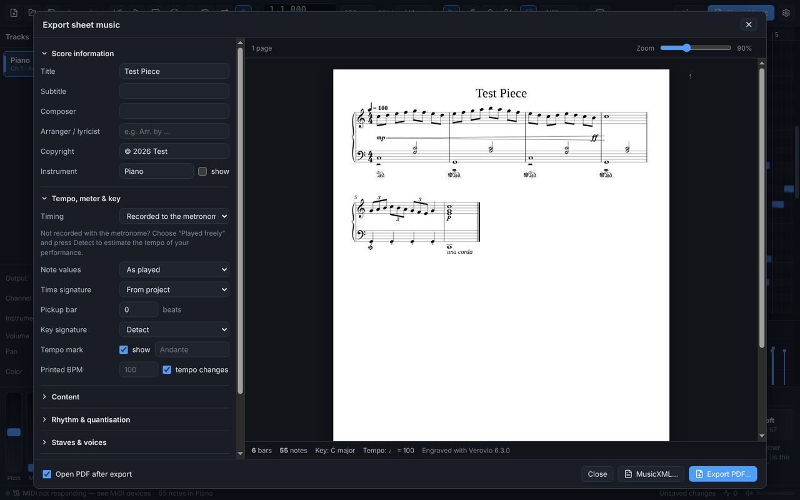

# Sheet music export

Synth Piano turns the MIDI data of a project into engraved sheet music. You can save it
as **PDF** (vector, print-ready) or as **MusicXML**, which opens in MuseScore, Dorico,
Finale, Sibelius and other notation programs.

Open the exporter with **File → Export Sheet Music…**, the **Sheet Music** button in the
toolbar, or <kbd>Ctrl</kbd>+<kbd>P</kbd>.

The left side holds every export parameter, grouped into sections. The right side is a
**live preview**. Each change is re-engraved after a short pause, in the background, so
the editor stays responsive. The preview shows exactly what the PDF will contain: the
same pages, line breaks and fonts. Below the preview you'll see the number of bars and
notes, the detected key and tempo, and any warnings, such as notes outside the selected
bars.

Your settings are saved with the project, so the next export starts where you left off.

---

## How a performance becomes notation

A live recording isn't written music yet. Notes start a few milliseconds early or late,
are held for uneven lengths, and both hands play at once. The exporter makes the same
decisions a person transcribing by ear would make:

1. **Timing.** Note times become musical beats, using the project tempo map or a
   tempo you give for free-time playing.
2. **Clean-up.** Ghost notes shorter than a threshold are dropped. Swung eighths can
   be straightened.
3. **Quantisation.** Each beat is checked to see whether it fits a straight grid or
   eighth-note triplets better. Notes then snap to that grid.
4. **Hands and staves.** Notes go to the treble or bass staff, either by following
   the hands or by a fixed split point.
5. **Note lengths and articulation.** Small gaps are closed, and clearly detached
   notes become staccato.
6. **Voices.** A held note under a moving melody becomes a second voice, so neither
   line is cut short.
7. **Bars and note values.** Notes are split at bar lines and written with values
   that respect the meter, with ties, beams and tuplets.
8. **Expression.**
   - Dynamics (*pp* to *ff*) and hairpins come from note velocities.
   - Pedal marks come from the sustain pedal (CC 64).
   - *una corda* / *tre corde* come from the soft pedal (CC 67).
   - Tempo marks come from the tempo map.
9. **Spelling and key.** The key is detected if you don't set it, and notes are
   spelled to match (F♯ in G major, G♭ in D♭ major).
10. **Engraving.** The score is laid out on pages by the
    [Verovio](https://www.verovio.org) engraving engine.

None of this changes your project. The exporter works on a copy of the data.

---

## Parameters

### Score information

| Parameter | Default | Notes |
| --- | --- | --- |
| Title | project title | Large, centred on page 1. Repeated small on later pages if *Title on following pages* is on. |
| Subtitle | project subtitle | Below the title. |
| Composer | project composer | Right-aligned above the music. |
| Arranger / lyricist | project arranger | Left-aligned, italic (for example "Arr. by …"). |
| Copyright | project copyright | Small print at the bottom of page 1. |
| Instrument (+ *show*) | instrument of the first track | Printed before the first line when *show* is on. In *One instrument per track* mode the track names are always shown. |

### Tempo, meter & key ("speed")

| Parameter | Default | Notes |
| --- | --- | --- |
| **Timing** | Recorded to the metronome | *Recorded to the metronome*: bars are taken from the project, which is right when you recorded with the click or drew notes on the grid. *Played freely*: the performance is re-timed with the tempo below, for recordings made without a click. |
| Played at (BPM) | project tempo | *Free timing only.* The tempo you actually played. **Detect** estimates it, and the first beat, by fitting a beat grid to the note onsets. |
| Music starts at (s) | 0 | *Free timing only.* Time of the first beat. Set automatically by **Detect**. |
| Note values | As played | *Double time* halves every note value (eighths become sixteenths). *Half time* doubles them. Use this when the music "looks" twice too fast or too slow; the printed BPM is adjusted to match. |
| Time signature | From project | Overrides the meter, for example to write a 4/4 recording in 12/8. |
| Pickup bar | 0 beats | Length of an anacrusis in quarter notes. The exporter suggests a value (**Use …**) when the music starts late in the first bar. |
| Key signature | Detect | *Detect* uses Krumhansl–Schmuckler key finding on the notes. *From project* uses the key set in *Project Info*. *Choose…* picks any major or minor key. |
| Tempo mark | shown, no text | Shows the metronome mark (♩ = 120, or ♩. for compound meters). Add text such as *Allegro*, *Swing* or *Rubato*; an Italian term matching the tempo is suggested. |
| Printed BPM | auto | Overrides the number in the metronome mark without changing the rhythm. |
| tempo changes | on | Writes extra tempo marks where the project tempo changes. Very dense tempo maps (rubato imports) are skipped with a warning. |

### Content

| Parameter | Default | Notes |
| --- | --- | --- |
| Tracks | all tracks with notes | Choose which tracks to print. |
| Layout of tracks | Combine into one instrument | *Combine* merges the selected tracks into one part (for example left and right hand recorded separately). *One instrument per track* writes a system with one part per track (an ensemble score). |
| Bars from … to … | 1 – end | Export part of the piece. Bar numbers follow the project. |
| Skip empty bars at the start | on | Removes count-in or silent bars, so the score starts with bar 1. |
| Transpose | concert pitch | Presets for B♭ (+2), E♭ (+9) and F (+7) instruments and octave shifts, or any number of semitones. The key signature is transposed too. |

### Rhythm & quantisation

| Parameter | Default | Notes |
| --- | --- | --- |
| Shortest note | Sixteenth | The finest rhythm written. Coarser values give simpler, more readable scores. |
| Detect triplets | on | Each beat is tested for an eighth-note triplet grid. A beat is written as a triplet only if at least two notes clearly fit it better. |
| Swing feel → straight eighths | off | For swing recordings: long-short pairs are written as straight eighths (add "Swing" as tempo text). |
| Note lengths | Clean | *Clean* closes small gaps between notes, so a slightly detached quarter stays a quarter and doesn't become an eighth plus a rest. *Exactly as played* keeps every rest. *Legato* holds each note until the next one (up to a whole note). |
| Ignore notes under | 30 ms | Drops accidental grazes ("ghost notes"). |
| Lengthen notes held by the pedal | off | Writes notes until the sustain pedal is released instead of until the key is released. |

### Staves & voices

| Parameter | Default | Notes |
| --- | --- | --- |
| Staves | Automatic | *Automatic* uses a grand staff when the music spans both registers, otherwise a single treble or bass staff. You can also force a grand staff, treble only or bass only. |
| Hand split | Smart | *Smart* follows each hand's position over time. It avoids impossible stretches and crossed hands, and keeps close chords in one hand. *Fixed* splits at the split point. |
| Split point | C4 (middle C) | For *Fixed*: notes at or above go to the upper staff. |
| Voices per staff | Up to 2 | Two voices keep a held note under a moving melody. *1* produces only chords, the simplest reading. |

### Dynamics & expression

| Parameter | Default | Notes |
| --- | --- | --- |
| Dynamics | on | *ppp* to *fff* from the loudness of the louder half of the notes in each bar. A new mark is printed only when the level clearly changes. |
| Sensitivity | Medium | *Low* gives few marks; *High* analyses half bars and reacts to smaller changes. |
| Hairpins | on | Crescendo and diminuendo where the melody velocity rises or falls steadily over several beats. A target dynamic is added at the end. |
| Sustain pedal | Ped. / ✱ symbols | From CC 64. Quick release-and-press becomes a pedal change. *Pedal brackets* draws lines instead; *Not shown* omits pedalling. |
| Soft pedal | on | *una corda* / *tre corde* from CC 67. |
| Staccato | on | Short notes followed by a gap (at most half of the time to the next note) get a staccato dot. |
| Accents | off | Notes at least 20 velocity steps louder than their neighbours get an accent. |

### Page layout

| Parameter | Default | Notes |
| --- | --- | --- |
| Paper | A4 | A4, A3, A5, B4, US Letter, US Legal or Tabloid. |
| Orientation | Portrait | Landscape is useful for wide ensemble scores. |
| Staff size | 7 mm | Height of a five-line staff: 5–5.5 mm is compact, 7 mm standard, 8–9 mm large print (beginners, sight reading). |
| Margins | 12 / 12 / 14 mm | Top, bottom and left/right margins. |
| Bars per line | auto | A fixed number of bars per system, for exercises or lead sheets. |
| Lines per page | auto | Maximum number of systems on a page. |
| Bar numbers | At the start of each line | Or every bar, every 5 bars, or none. |
| Spacing | Normal | Compact or spacious distance between staves and systems. |
| Music font | Leipzig | Leipzig (classic), Bravura (bold), Leland (MuseScore style), Gootville (light) or Petaluma (handwritten / jazz). |
| Spread lines over the full page | off | Justifies systems vertically. |
| Page numbers | on | Centred at the bottom of every page after the first. |
| Title on following pages | on | Small running title at the top of pages 2 and onwards. |

### Output

* **Export PDF…** — vector PDF with embedded fonts, the same pages as the preview.
  *Open PDF after export* opens it in your default viewer.
* **MusicXML…** — the same score as editable notation for other programs.

---

## Tips for the best results

* **Record with the metronome** (count-in on), or draw on the grid. Then *Recorded to the
  metronome* timing gives exact bars.
* For free playing, use *Played freely* and **Detect**. Then check the preview: if
  everything looks twice as fast, switch *Note values* to *Half time*, or the other way
  round.
* Choose the **shortest note** you really play. A sixteenth grid on a piece of quarters
  and eighths can turn small timing errors into dotted rhythms.
* If the hands are assigned oddly, switch *Hand split* to *Fixed* and move the split point.
* For pieces with a pickup, use the suggested *Pickup bar* value.
* Velocity and pedal data are only as good as the recording. Use the controller lanes
  under the piano roll to fix a missing pedal release or a wrong velocity before
  exporting.
